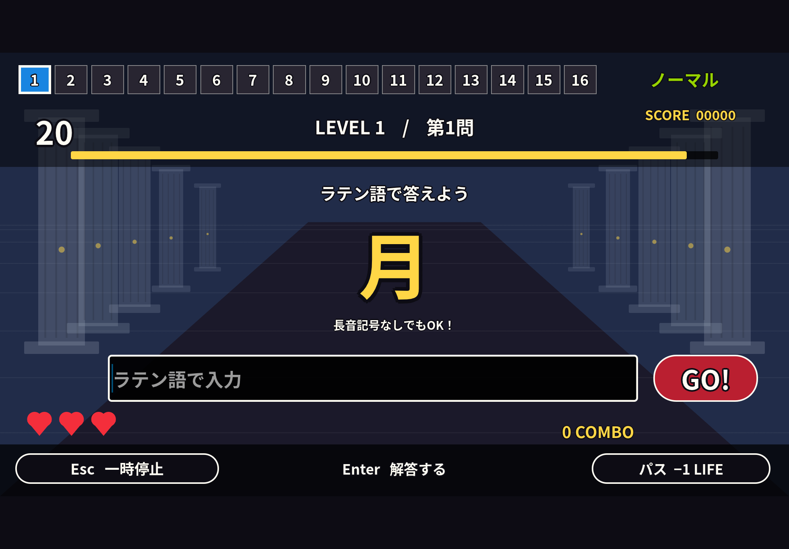
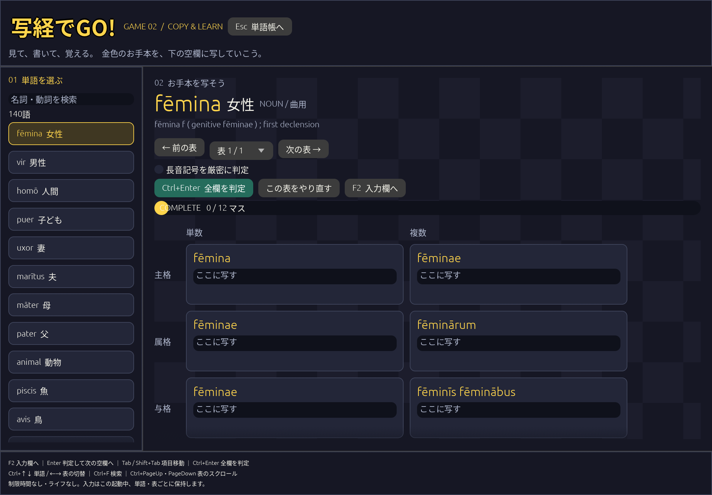

# Latina — ラテン語単語帳

Rust / egui のデスクトップアプリです。SQLiteに見出し語、日本語訳、名詞などの変化表、動詞の圧縮辞書情報、習得状態を保存します。日本語フォントと初期データを同梱しており、通常利用にインターネット接続は不要です。

## 起動

Rustの開発環境を用意して、このディレクトリで実行します。

```sh
cargo run
```

LinuxではX11またはWaylandとOpenGLが必要です。BGMのビルドにはALSA開発パッケージ（Debian/Ubuntuでは `libasound2-dev`）と `pkg-config` も必要です。Windows/macOS向けのネイティブ配布・動作検証はまだ行っていません。

```sh
# DBを任意の場所に置く
cargo run -- --db ./vocabulary.sqlite3
# ウィンドウを開かず、初期データの読み込みを確認
cargo run -- --db /tmp/latin-vocab-check.sqlite3 --check
cargo test
python3 -m unittest discover -s scripts -p 'test_*.py'
```

標準の保存先はOSのアプリデータディレクトリです。Linuxでは通常 `~/.local/share/latin-vocab/vocabulary.sqlite3` になり、画面下部にも表示します。バックアップはアプリを閉じてDBファイルをコピーしてください。

## 使い方

- 一覧から単語を選ぶと、日本語訳・辞書の基本情報・変化表を表示します。
- 日本語・ラテン語・英語の概念名で検索できます。ラテン語検索は長音記号・大文字小文字を区別しません。表示・保存では長音記号を保持します。
- 「学習する」で答えを隠して確認できます。「日本語 → ラテン語」で出題方向を変更できます。
- 「覚えた」「もう一度」で習得状態を記録します。「未習得のみ」で対象を絞れます。出題はリスト順に循環する方式です。

## ゲーム「ラテン語でGO!」

上部の「ゲームで遊ぶ」から開きます。`cargo run -- --game` は難易度選択、`cargo run -- --play` はノーマルの出題を直接開始します。




- 緑・橙・赤の難易度カード、市松模様、縁取り文字、16問の進行マスを備えた専用画面です。背景と装飾はコードで描画しています。
- 「↓ 出題・設定」で日本語→ラテン語、ラテン語→日本語、活用チャレンジを選択できます。活用問題は名詞の6格・2数と通常動詞の定形活用から出題します。初期データにない重要不規則動詞の活用問題は現在対象外です。
- 通常問題は1ラウンド最大16問、ライフ3。復習問題は別枠で追加されます。4問ごとにLEVELが上がります。通常問題では同じ概念番号の重複出題を避け、対象が少ない場合はその件数で終了します。難易度別の1問の制限時間はノーマル20→18→16→14秒、ハード12→10→8→6秒、ゲキムズ8→7→6→5秒です。
- Enterまたは「GO!」で解答。空欄は送信しません。誤答・時間切れ・パスでライフを1つ消費します。正解時は自動で次へ進み、誤答時は正解を確認してから進めます。
- 誤答・時間切れの問題は、通常問題を2問挟んで同じ条件・同じ正解で復習出題します。終盤は残りの通常問題が終わった後に出題します。復習正解でライフが1回復（上限3）、得点・コンボは増えません。パスは復習対象外。同じ問題の復習は1回までで、復習で誤答・時間切れ・パスの場合もライフを消費します。ライフ0になれば復習を待たず終了します。
- ラテン語の大文字小文字・全角半角は区別せず、通常は長音記号も省略できます。「長音記号を区別」で厳密に判定できます。日本語は収録訳と登録済みのひらがな・カタカナ読みを受け付けます。任意の同義語を推論する方式ではありません。読みの追加は `data/game_readings.json` で行います。
- オリジナルのチップチューン風BGMをループ再生します。メニュー・結果画面は128 BPM、プレイ中は168 BPMの戦闘風BGM（短調のメロディー、16分音符のベース、キック・スネア）に切り替わります。「出題・設定」のBGMチェックでミュート、音量スライダーで調整できます（起動時20%、設定は今回の起動中のみ保持）。一時停止・単語帳への移動・フォーカス喪失でBGMも停止します。音声デバイスが使えない場合は無音で利用でき、設定画面から再試行できます。
- SEは開始・正解・不正解・時間切れ・パス・クリア・ゲームオーバーの7種類です。「出題・設定」のSEチェックと音量でBGMとは独立して調整できます（起動時45%）。一時停止・画面を離れた場合やミュート中のSEは後からまとめて再生しません。
- Escで一時停止。ウィンドウからフォーカスが外れたときも停止し、「つづける」で再開します。「諦める」でそのラウンドを終了し、難易度選択へ戻ります。諦めたラウンドの成績は保存しません。
- 正解100点＋残り時間に応じた最大50点＋連続正解数×10点（最大100点）。結果から間違えた単語の詳細へ移動できます。
- 回復ルール導入前の記録は保持し、新ルールの最高得点とは分けて管理します。最高得点とプレイ回数はSQLiteの `game_records` に出題方向・難易度・長音記号設定・未習得設定別で保存します。途中で終了したラウンドは記録しません。習得状態は単語帳で操作します。

動詞の出題用活用も主要部分と規則・overrideからメモリ上で生成します。通常動詞の全活用をDBへ保存しない方針を維持しています。

画面検証用には `screenshot` featureを用意しています。`LATINA_SCREENSHOT_TO=/tmp/latina.png cargo run --features screenshot -- --game` で実画面のPNGを保存して終了します。この撮影モードだけはフォーカス状態を固定します。

## ゲームその二：写経練習

上部の「写経練習」または単語帳で Ctrl+4 を押すと開きます。`cargo run -- --copy` で直接起動できます。



「出題範囲を選択」で名詞の第1〜第5変化、動詞の現在・未完了過去・未来・完了・過去完了・未来完了を複数選択できます。動詞は直説法・接続法・命令法と能動態（異態動詞を含む）・受動態も選択できます。不定詞・分詞などはランダム出題の対象外ですが、手動選択で練習できます。名詞の変化型は収録済みの辞書情報から判定します。

F3または「範囲からランダム出題」で、該当する単語と表を抽選します。同じ見出し語を重複して抽選候補にせず、複数候補があれば直前と違う単語を選びます。検索欄は手動一覧用で、ランダムの範囲には影響しません。候補がない場合は入力中の問題を保持して範囲変更を案内します。

「空欄数」は1〜24、初期値4。複数の語形がある表では最低1マスを記入済みとして残し、それ以外からランダムに空欄を作ります。小さい表では空欄数が指定数より少なくなります。空欄の正解は隠れていますが、「空欄のお手本も表示」を選べば写経として使えます。判定と進捗の対象は空欄のみです。F3で次の問題へ進むとランダム問題の入力はリセットされます。範囲・空欄数の変更は次の出題から適用します。

従来どおり、左の一覧から手動で名詞・動詞を選び、お手本を見ながら変化表の各マスを埋めることもできます。各マスの上が見本、下が入力欄です。動詞の定形活用は、1つの法・態・時制ごとに「1〜3人称 × 単数・複数」の6マスで表示します。複数の時制を選んだランダム出題も、そのうち1時制の表を抽選します。存在しない人称形は「—」で示して入力対象から外します。不定詞などは別の表で練習できます。通常動詞は既存の主要部分・規則・overrideから表を生成し、DBには生成表を保存しません。

- F2 または「入力欄へ」で未完了の欄へ移動。Enterで判定し、正解なら次の未完了欄へ、不正解なら同じ欄で書き直します。
- Ctrl+Enter または「全欄を判定」でまとめて確認します。全マス正解で「写経完了」と表示します。
- 異形は1つだけでも、見本のセル全体を書いても正解です。動詞の複合形は `rēcta sum` のように必要な単語を全部入力します。欠如を表す「—」は入力対象外です。
- 通常は長音記号を省略できます。「長音記号を厳密に判定」を有効にすると長音も確認します。大文字小文字・全角半角は区別しません。
- Ctrl+↑↓で単語、Ctrl+←→で表を切り替え。Ctrl+Fで検索、Ctrl+PageUp・PageDownで縦スクロール。Tab／Shift+Tabでも操作できます。横に長い動詞の表は、入力欄にフォーカスが移るとその欄までスクロールします。
- Escで単語帳へ戻ります。書きかけの入力と判定は、この起動中は単語・表ごとに保持します。アプリを閉じるとリセットされます。「この表をやり直す」は現在の表だけを空欄に戻します。

制限時間・ライフ・採点ランキングはありません。単語帳の習得状態は変更しません。

## キーボード操作

マウスを使わず、Tabで次の操作項目、Shift+Tabで前の項目へ移動し、EnterまたはSpaceで決定できます。ゲームのボタンはフォーカス中に金色の枠が付きます。チェックボックスはSpace、音量スライダーは左右キーで変更します。

- 難易度選択：←→で難易度、↓で設定。フォーカスがないときはSpaceで開始。ボタンにフォーカスがある場合はそのボタンを優先します。
- プレイ：入力欄でEnterを押すと解答。F2キー1つでパス（ライフ−1）。解答入力中も使え、長押しのリピート・正解確認中・一時停止中はパスしません。Tabで「GO!」「一時停止」「パス」へ移動できます。日本語変換確定のEnterでは解答しません。
- 一時停止：Tabで「つづける」「諦める」「単語帳へ戻る」を選びEnter。Escでも再開できます。
- 設定：Tabで出題方向、長音判定、未習得限定、BGM・SEの有効化と音量、再試行、決定へ移動。Escで設定を閉じます。
- 結果：Tabで間違えた問題の復習、保存再試行（エラー時）、単語帳、難易度選択、再挑戦を選べます。Escで難易度選択に戻ります。

単語帳では次のショートカットも使えます。すべてCtrlと組み合わせます。

| キー | 操作 |
| --- | --- |
| 1 / 2 / 3 / 4 | 単語一覧 / 学習 / ゲーム / 写経練習 |
| F | 検索欄へ移動 |
| ↑ / ↓ | 前 / 次の単語 |
| Enter | 学習カードの答えを表示 |
| K / J | 覚えた / もう一度 |
| R / U | 出題方向変更 / 未習得のみ切替 |
| PageUp / PageDown | 変化表を上下にスクロール |
| ← / → | 変化表を左右にスクロール |

## 初期データ

[WiktionaryのLatin Swadesh list](https://en.wiktionary.org/wiki/Appendix:Latin_Swadesh_list) の207項目版から、各概念の先頭の対応語を選んでいます。すべての同義語を収録するものではありません。

207概念に日本語訳を付与しています。137項目は変化表を直接保持し、56項目の動詞は表示時に活用表を生成します。14項目は不変化語です。概念数と見出し語数は異なります。たとえば「私」「私たち」は見出し語 `ego` を共有し、リスト上の語形 `egō` / `nōs` を別に保存します。`quid` は `quis` に、複数形 `omnēs` は `omnis` に対応づけています。

変化表は辞書のLatin節から取得しています。同綴りの `volō` は「飛ぶ」の `volāre` の活用を採用し、`os`（骨）と `ōs`（口）は別の見出し語として保存します。日本語訳はスワディシュリストの概念を示す短い訳で、辞書の全語義を翻訳したものではありません。訳語とラテン語の語義の対応は今後の校訂対象です。

直接保持する表は、不規則変化・異形も保持できるセル配列です。結合セルは展開し、格・数・時制などの代表的な見出しを画面上で日本語に置き換えます。`classical-school-1` の明示的な語形選択を適用し、古典ラテン語の標準的な学習用パラダイムに限定します。除外した異形すべてを「非古典」と分類するものではなく、古典期にもある詩的・稀な異形を学習範囲から外す場合もあります。

## 名詞と動詞の保存方針

| 対象 | 永続化する内容 | 表示時の処理 |
| --- | --- | --- |
| 名詞（および既存の形容詞・代名詞など） | 各語形を含む変化表 | 保存表を表示 |
| 通常動詞 | 構造化した主要部分・活用型・属性・個別override | 規則で生成し、overrideを優先 |
| 重要不規則動詞 | 活用表と不定詞による識別情報 | 保存表を表示 |

通常動詞の例（`verb` フィールド）：

```json
{
  "kind": "regular",
  "principal_parts": {
    "present": "regō",
    "infinitive": "regere",
    "perfect": ["rēxī"],
    "supine": ["rēctum"]
  },
  "conjugation": "third",
  "overrides": {}
}
```

活用型は `first`, `second`, `third`, `third_io`, `fourth`。完了・supineに複数の主要形がある場合は配列に保存します。欠ける主要部分は空配列とし、対応する形を推測で補いません。現在系列の基底は不定詞から、完了語幹は完了1人称の `-ī` を除いて、supine語幹は `-um` を除いて取得します。第3活用のテーマ母音交替は生成規則が担当します。

規則は [Allen & Greenough §164（語幹）](https://dcc.dickinson.edu/grammar/latin/stems)、[§184以降（活用）](https://dcc.dickinson.edu/grammar/latin/1st-conjugation)、[§190以降（異態動詞）](https://dcc.dickinson.edu/grammar/latin/deponent-verbs) を参照しています。

生成範囲は、直説法6時制・接続法4時制・命令法の現在/未来、能動/受動の不定詞、分詞の基本形、動名詞4格、目的分詞2格です。完了受動態は完了分詞と `sum` の明示的な補助動詞データを組み合わせ、性・数に応じた形を併記します。不定詞の分詞部分は対格で生成します。分詞の全格変化、古いsigmatic形、すべての縮約・異綴りの網羅は生成範囲に含めていません。

異態動詞は `deponent: true` と `perfect_participle` を使います。受動態の制限は `passive: "none"` または `"impersonal"`。`morior`・`stō` の未来分詞などには `future_participle_stem`、`dō` の短いテーマ母音には `short_a` を使います。これらも単語ごとの表全体を持たず、必要な情報だけを保存します。

例外のキーは `法.態.時制.人称数` です。たとえば `dīcō` の短い命令形：

```json
"overrides": {
  "imperative.active.present.2s": ["dīc"]
}
```

`1s`〜`3s` が単数、`1p`〜`3p` が複数です。配列はそのセルの生成結果を**置換**します。複数形を列記すると異形を併記し、空配列 `[]` は該当セルを欠如扱いにします。不定詞などは `infinitive.passive.present`、`gerund.genitive` のようなキーを使います。未知のキーはエラーにして綴り間違いを見逃しません。`olfaciō` の補充的な受動形もこの仕組みを使います。

重要不規則語の判定対象は `sum/esse`, `possum/posse`, `ferō/ferre`, `eō/īre`, `volō/velle`, `nōlō/nōlle`, `mālō/mālle`, `fīō/fierī`。`verb` は `{"kind":"irregular","infinitive":"esse"}` の形で指定し、全活用表を `tables` に保存します。初期リストの `volō/volāre`（飛ぶ）は第1活用として生成します。現在の207項目の動詞はすべて `regular` 方式（個別例外を含む）です。

## データ構造と移行

- `lexemes`: 見出し語・品詞・基本情報・出典・収録方式
- `concepts`: スワディシュ番号・見出し語への参照・リストの語形・日本語訳・英語概念名
- `paradigms`: 直接保持する変化表（順序付きJSONセル配列）
- `verb_specs`: 動詞の主要部分・活用型・属性・override、または重要不規則語の識別情報
- `progress`: 概念ごとの習得状態
- `game_records`: 設定別の最高得点・完了したラウンド数
- `metadata`: 初期辞書のバージョンとDBスキーマバージョン

通常動詞の `tables` は空です。生成結果は画面表示用の一時データで、SQLiteにも同梱JSONにも保存しません。SQLiteのトリガーも通常動詞の表の保存を拒否します。

初回起動で同梱JSONをトランザクション内で投入します。旧版DBは次回起動時にスキーマv2へ自動移行し、通常動詞の表を削除して `verb_specs` に置き換えます。単語ID・名詞などの表・日本語訳・出典・習得状態は維持します。旧版の主要部分が手編集されていて安全に対応づけられない場合は、移行をロールバックしてエラーにします。

古典学習用語形への変更は次回DBを開いたときにトランザクションで反映します。習得状態・ゲーム記録・単語IDは維持します。既知の旧データとも新データとも一致しない個別編集がある場合は上書きせず、移行全体を中止します。通常のJSON再生成だけで既存DBの任意の編集内容を一括更新することはありません。

## データの再生成

Pythonと `scripts/requirements.txt` の依存が必要です。

```sh
python3 -m venv .venv
.venv/bin/pip install -r scripts/requirements.txt
.venv/bin/python scripts/import_swadesh.py
```

HTMLは `data/cache/` にキャッシュされ、再実行で再利用します。初回はWiktionaryに接続します。失敗時は既存JSONを上書きしません。ソース側のHTML構造が変わる場合に備え、再生成後に `cargo test` で件数・語形・保存方式・同綴り語の対応を確認してください。動詞は `scripts/verb_data.py` で構造化し、通常動詞の取得表は出力前に破棄します。

`cargo run --example export_forms` で規則生成とoverride適用後の語形を標準出力へ出力できます。DBへの書き込みは行いません。

## 出典とライセンス

`data/swadesh.json` は Wiktionary contributors によるリスト・辞書の変化表を抽出・再構成し、日本語訳を追加したデータです。このデータは [CC BY-SA 4.0](https://creativecommons.org/licenses/by-sa/4.0/) で提供します。各項目の `source` から原文とその履歴（著者一覧）を参照できます。取得日はJSONの `retrieved` に記録しています。

同梱する Noto Sans CJK は SIL Open Font License 1.1。著作権表示とライセンス全文は [assets/FONT-LICENSE.txt](assets/FONT-LICENSE.txt) を参照してください。

## 古典ラテン語の語形方針

語形の校訂ルールは `data/classical_profile.json`。現在55見出し語について、修正前後の表・主要部分・例外を明示しています。修正前の値は移行照合用で、辞書表示や正解候補としては使いません。再取り込みも `scripts/classical_profile.py` で同じルールを適用し、未知の出典変更は校訂が必要なエラーにします。

- `fēmina` の複数与格・奪格は `fēminīs`。`fēminābus` は保存・表示・正解候補から除外します。
- 代名詞表の古綴りや脚注番号、`os` の `ossua / ossuum` などを除外。人称代名詞は単数・複数を備えた学習用表にまとめます。
- `edō` の主要部分は `ēsum` を採用し、古形由来の重複と「+ sumの活用」といった説明文のoverrideを除去。完了受動形は `ēsus sum` などを規則生成します。通常動詞の全活用はDBへ保存しません。
- 語尾の一律削除は行いません。`dea / fīlia` の `-ābus`、古典語の異形などは語と文法事項ごとに判断します。この版は学習用の選択であり、全時代の用例を自動で年代判定する仕組みではありません。

参照：Allen and Greenough, [第1変化の格語尾](https://dcc.dickinson.edu/grammar/latin/1st-declension-case-forms)、[人称代名詞](https://dcc.dickinson.edu/grammar/latin/personal-pronouns)、[第4変化](https://dcc.dickinson.edu/grammar/latin/4th-declension-stem-paradigm-and-gender)、[第3変化の不規則名詞](https://dcc.dickinson.edu/grammar/latin/3rd-declension-irregular-nouns)、[edō (§201)](https://www.hhhh.org/perseant/libellus/aides/allgre/allgre.201.html)。初期の語形データの出典とライセンスは上記Wiktionaryの表記に従います。
