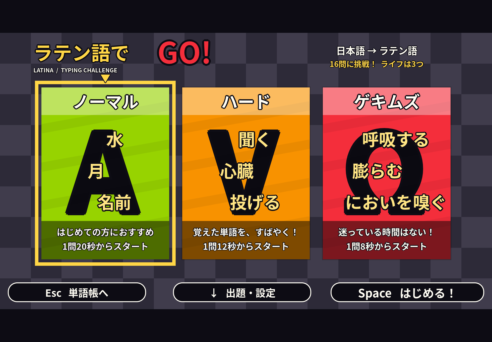
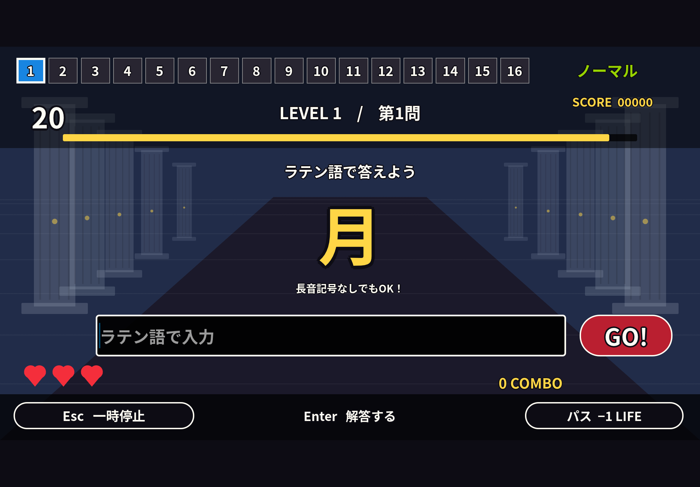
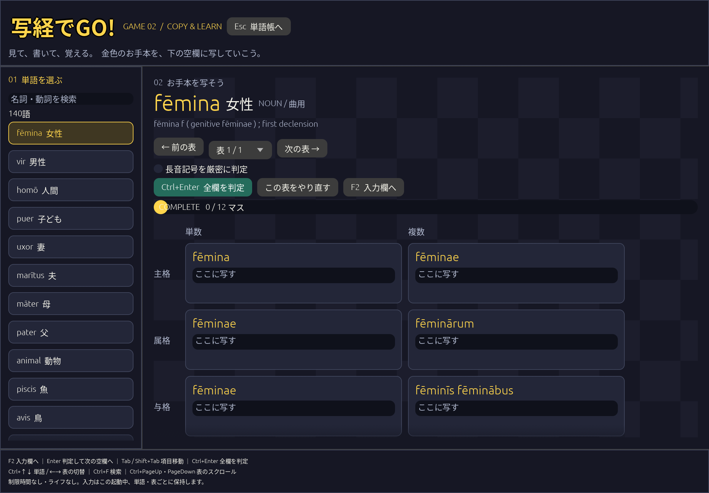

# Latina — Latin Vocabulary and Morphology Practice

A Rust / egui desktop application for studying Latin with Japanese explanations. It stores vocabulary, translations, inflection data, learning progress, and game records in SQLite. Japanese fonts and seed data are bundled, so ordinary use does not require an internet connection.

The application interface is currently in Japanese.

## Getting started

```sh
git clone https://github.com/tsubakichan-289/latin-vocab.git
cd latin-vocab
cargo run
```

On Linux, the application requires X11 or Wayland and OpenGL. Building audio support also requires ALSA development files, such as `libasound2-dev` on Debian/Ubuntu, and `pkg-config`. Native Windows and macOS distributions have not been tested or provided.

Additional commands:

```sh
# Choose a database location
cargo run -- --db ./vocabulary.sqlite3

# Check seed-data loading without opening a window
cargo run -- --db /tmp/latin-vocab-check.sqlite3 --check

# Run the tests
cargo test
python3 -m unittest discover -s scripts -p 'test_*.py'
```

The default database is stored in the OS application-data directory, usually `~/.local/share/latin-vocab/vocabulary.sqlite3` on Linux. Its path is displayed at the bottom of the window. Close the application before copying the database for backup.

## Vocabulary and study cards

Select an entry to view its Japanese translation, dictionary information, and inflection tables. Search accepts Japanese, Latin, and English concept names. Latin searches ignore case and macrons, while stored and displayed spellings retain macrons.

Study mode hides the answer until requested. You can switch the question direction, mark a concept as learned or needing another attempt, and restrict practice to unlearned concepts. Cards cycle through the list in order.

## Latin GO!

Open the game from the vocabulary screen, or use:

```sh
cargo run -- --game   # Difficulty selection
cargo run -- --play   # Start a normal-difficulty round
```





The game supports Japanese-to-Latin, Latin-to-Japanese, and inflection challenges. Inflection questions cover six noun cases in two numbers and finite forms of regular verbs. Major irregular verbs that are absent from the seed data are not currently included in these questions.

A round has up to 16 ordinary questions and starts with three lives. The level increases every four questions. Each ordinary question uses a distinct concept number where possible; if fewer concepts are available, the round ends after that smaller set.

| Difficulty | Time per question at successive levels |
| --- | --- |
| Normal | 20, 18, 16, 14 seconds |
| Hard | 12, 10, 8, 6 seconds |
| Extreme | 8, 7, 6, 5 seconds |

Press Enter or **GO!** to submit an answer. Empty input is not submitted. An incorrect answer, timeout, or pass costs one life. Correct answers advance automatically; incorrect answers show the expected answer before continuing.

Incorrect and timed-out questions return once for review after two intervening ordinary questions, or at the end of the remaining questions. A correct review answer restores one life, up to three, without increasing score or combo. Passed questions are not reviewed. A round ends immediately when lives reach zero.

Latin answers ignore case and full-width/half-width differences. Macrons are optional unless strict macron checking is enabled. Japanese answers accept the stored translations and registered hiragana/katakana readings in `data/game_readings.json`; arbitrary synonyms are not inferred.

Correct ordinary answers receive 100 points, up to 50 time-bonus points, and a consecutive-answer bonus of 10 points per step, capped at 100. The result screen links to vocabulary details for missed questions. High scores and completed-round counts are stored by question direction, difficulty, macron setting, and unlearned-only setting. Records from before the life-recovery rule remain separate. Abandoned rounds are not recorded, and game play does not change vocabulary learning status.

### Sound and pausing

The game includes original synthesized chiptune-style music: 128 BPM for menus/results and 168 BPM during play. Music and sound effects have independent mute and volume controls, initially 20% and 45%. Settings last for the current session.

Sound effects cover start, correct answer, incorrect answer, timeout, pass, clear, and game over. Muted or paused effects are not queued for later playback. If an audio device is unavailable, the game remains usable without sound and offers a retry control.

Esc pauses the game. Losing window focus also pauses play and music. Resume explicitly to continue. Quitting a round returns to difficulty selection without saving its result.

### Capturing a screenshot

The optional `screenshot` feature saves the actual rendered game screen and exits:

```sh
LATINA_SCREENSHOT_TO=/tmp/latina.png cargo run --features screenshot -- --game
```

Only this capture mode forces the focus state used by the game.

## Copy and fill-in practice

Open copy practice from the top bar, press Ctrl+4 in the vocabulary view, or run:

```sh
cargo run -- --copy
```



Select noun declensions 1–5 or verb tenses, moods, and voices to define the practice pool. Verb choices include indicative, subjunctive, and imperative forms, with active/deponent and passive options. Infinitives and participles are available through manual table selection, rather than random questions.

Press F3 to choose a random eligible word and table. A lemma appears only once in the candidate pool, and the previous word is avoided when another candidate exists. Search filters the manual list without changing the random pool. If no candidates match, the current exercise is retained.

Choose 1–24 blanks, with four as the default. Tables with multiple forms retain at least one filled cell as an example, so small tables can contain fewer blanks than requested. You can reveal the blank cells' models for copying practice. Only blank cells contribute to progress and checking. Changes to the pool and blank count apply to the next question.

Manual practice also lets you choose a word and fill its tables while viewing examples. Finite verb tables show six person/number cells for one mood, voice, and tense. Missing forms are marked with an em dash and are not editable. Regular-verb tables are generated from principal parts, rules, and overrides; generated tables are not saved to the database.

| Key | Action |
| --- | --- |
| F2 | Focus an unfinished cell |
| Enter | Check the current cell; advance if correct |
| Ctrl+Enter | Check all cells |
| F3 | Choose a new random exercise |
| Ctrl+↑ / Ctrl+↓ | Select the previous/next word |
| Ctrl+← / Ctrl+→ | Switch tables |
| Ctrl+F | Focus search |
| Ctrl+PageUp / Ctrl+PageDown | Scroll vertically |
| Esc | Return to the vocabulary view |

One accepted variant or the full model cell is sufficient. Compound forms require all their words, such as `rēcta sum`. Macrons are optional unless strict checking is enabled. Case and full-width/half-width differences are ignored.

Inputs and checking state are retained per word/table for the current session and reset when the application closes. Resetting a table clears only that table. Copy practice has no timer, lives, or score ranking and does not change vocabulary learning status.

## Keyboard navigation

Use Tab and Shift+Tab to move between controls, then Enter or Space to activate them. Focused game buttons have a gold outline. Space toggles checkboxes; arrow keys adjust volume sliders.

In difficulty selection, ←/→ chooses a difficulty and ↓ moves to settings. Space starts a round when no button has focus. During play, Enter submits from the input field, except when confirming Japanese IME composition. F2 passes a question once, costing one life; repeated key events, pause, and answer-confirmation screens do not trigger extra passes.

In the vocabulary view, all shortcuts below use Ctrl:

| Key | Action |
| --- | --- |
| 1 / 2 / 3 / 4 | Vocabulary / study cards / game / copy practice |
| F | Focus search |
| ↑ / ↓ | Previous/next entry |
| Enter | Reveal the study-card answer |
| K / J | Mark learned / try again |
| R / U | Switch question direction / toggle unlearned-only |
| PageUp / PageDown | Scroll inflection tables vertically |
| ← / → | Scroll inflection tables horizontally |

## Seed data

The bundled dataset selects the first listed equivalent for each of the 207 concepts in the [Latin Swadesh list on Wiktionary](https://en.wiktionary.org/wiki/Appendix:Latin_Swadesh_list). It does not include every synonym.

All 207 concepts have Japanese translations. Of these entries, 137 retain explicit inflection tables, 56 generate verb forms for display, and 14 are indeclinable. Concept counts differ from lemma counts: for example, the concepts for “I” and “we” share the lemma `ego` while retaining the list forms `egō` and `nōs` separately.

Tables are drawn from the Latin dictionary sections. Homographs are distinguished: the bundled `volō` means “fly” and uses `volāre`, while `os` (“bone”) and `ōs` (“mouth”) are separate lemmas. Japanese translations describe the Swadesh concepts, rather than every dictionary sense; their alignment with Latin senses remains subject to revision.

The `classical-school-1` profile selects paradigms for classical Latin study. Excluded forms are not automatically classified as nonclassical; some poetic or rare classical variants are intentionally outside the learning scope.

## How inflection data is stored

| Entry type | Persistent data | Display behavior |
| --- | --- | --- |
| Nouns, adjectives, pronouns, and similar entries | Explicit inflection tables | Display the stored table |
| Regular verbs | Principal parts, conjugation, attributes, overrides | Generate forms, then apply overrides |
| Supported major irregular verbs | Full tables plus infinitive-based identity | Display the stored table |

A regular verb specification can look like this:

```json
{
  "kind": "regular",
  "principal_parts": {
    "present": "regō",
    "infinitive": "regere",
    "perfect": ["rēxī"],
    "supine": ["rēctum"]
  },
  "conjugation": "third",
  "overrides": {}
}
```

Conjugation types are `first`, `second`, `third`, `third_io`, and `fourth`. Perfect and supine principal parts are arrays so that alternatives can be retained. Missing parts use empty arrays; unavailable forms are not guessed.

Generation covers six indicative tenses, four subjunctive tenses, present/future imperatives, active/passive infinitives, basic participle forms, four gerund cases, and two supine cases. Perfect passive forms combine the participle with explicit forms of `sum`, including gender/number variants. Full participle declensions, old sigmatic forms, and every contracted or alternative spelling are outside the generation scope.

Deponents use `deponent: true` and `perfect_participle`. Other attributes include `passive: "none"` or `"impersonal"`, `future_participle_stem`, and `short_a`.

Overrides replace a generated cell. For example:

```json
"overrides": {
  "imperative.active.present.2s": ["dīc"]
}
```

Person/number keys run from `1s` to `3s` and `1p` to `3p`. Multiple values supply variants; an empty array makes the cell unavailable. Nonfinite keys include `infinitive.passive.present` and `gerund.genitive`. Unknown keys are rejected.

The irregular-verb identities supported by the storage model are `sum/esse`, `possum/posse`, `ferō/ferre`, `eō/īre`, `volō/velle`, `nōlō/nōlle`, `mālō/mālle`, and `fīō/fierī`. They use a specification such as `{"kind":"irregular","infinitive":"esse"}` and store their full paradigms in `tables`. The verbs currently included in the 207-concept seed all use the regular storage model, including per-verb exceptions.

The generation rules refer to Allen and Greenough's sections on [stems](https://dcc.dickinson.edu/grammar/latin/stems), [conjugation](https://dcc.dickinson.edu/grammar/latin/1st-conjugation), and [deponent verbs](https://dcc.dickinson.edu/grammar/latin/deponent-verbs).

## Database and migrations

| Table | Contents |
| --- | --- |
| `lexemes` | Lemmas, parts of speech, dictionary information, sources, storage mode |
| `concepts` | Swadesh numbers, lemma references, source forms, Japanese translations, English concepts |
| `paradigms` | Explicit tables stored as ordered JSON cell arrays |
| `verb_specs` | Regular-verb specifications or irregular-verb identities |
| `progress` | Learning status per concept |
| `game_records` | High scores and completed rounds by settings |
| `metadata` | Seed-data and database-schema versions |

Generated regular-verb tables are temporary display data. They are stored in neither SQLite nor the bundled JSON, and SQLite triggers reject attempts to persist them.

The first launch imports the seed data in a transaction. Older databases migrate to schema v2 by replacing regular-verb tables with `verb_specs`, preserving word IDs, other paradigms, translations, sources, and learning progress. If edited principal parts cannot be mapped safely, the migration rolls back.

Classical-profile updates are also transactional and preserve learning progress, game records, and word IDs. Unrecognized custom edits are not overwritten: the migration stops rather than applying a partial update. Regenerating the seed JSON does not indiscriminately replace custom edits in an existing database.

## Rebuilding the data

Requires Python and the dependencies listed in `scripts/requirements.txt`:

```sh
python3 -m venv .venv
.venv/bin/pip install -r scripts/requirements.txt
.venv/bin/python scripts/import_swadesh.py
```

Downloaded HTML is cached in `data/cache/`. The first run needs access to Wiktionary. A failed import does not overwrite the existing JSON. After regeneration, run `cargo test` to check counts, forms, storage conventions, and homograph handling. Regular-verb source tables are discarded after their specifications are extracted by `scripts/verb_data.py`.

Export generated forms, with overrides applied, without writing to the database:

```sh
cargo run --example export_forms
```

## Classical Latin profile

`data/classical_profile.json` records explicit corrections for 55 lemmas, including previous and replacement values. Previous values are retained only for migration matching. Reimports apply the same rules through `scripts/classical_profile.py`; unfamiliar upstream changes require review.

Examples include `fēminīs` for the plural dative/ablative of `fēmina`, the removal of certain archaic spellings and footnote markers, and `ēsum` as a principal part of `edō`, from which passive perfect forms such as `ēsus sum` are generated. The profile does not apply blanket ending removal: forms such as `dea / fīlia` in `-ābus` are assessed individually.

This is a curated learning profile, not an automatic historical classification of every attested form. References include Allen and Greenough on [first-declension case forms](https://dcc.dickinson.edu/grammar/latin/1st-declension-case-forms), [personal pronouns](https://dcc.dickinson.edu/grammar/latin/personal-pronouns), [the fourth declension](https://dcc.dickinson.edu/grammar/latin/4th-declension-stem-paradigm-and-gender), [irregular third-declension nouns](https://dcc.dickinson.edu/grammar/latin/3rd-declension-irregular-nouns), and [edō (§201)](https://www.hhhh.org/perseant/libellus/aides/allgre/allgre.201.html).

## Attribution and licenses

`data/swadesh.json` extracts and reorganizes lists and inflection tables contributed by **Wiktionary contributors**, with Japanese translations added. This data is distributed under [CC BY-SA 4.0](https://creativecommons.org/licenses/by-sa/4.0/). Each entry's `source` links to its source page, whose history identifies contributors. The retrieval date is recorded in the JSON's `retrieved` field.

The bundled **Noto Sans CJK** fonts use the **SIL Open Font License 1.1**. Copyright notices and the license text are included in [assets/FONT-LICENSE.txt](assets/FONT-LICENSE.txt).

---

[日本語版 README](README.ja.md)
